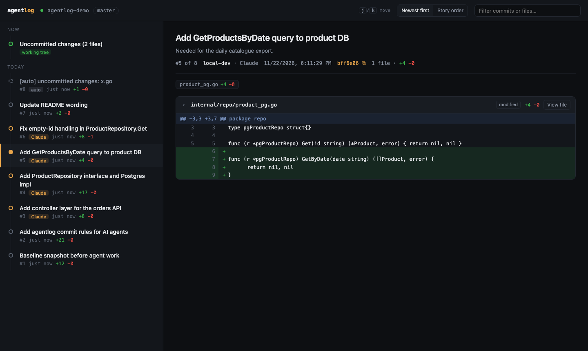

# agentlog

**Make your AI coding agent commit every change locally, then read what it did as a timeline.**

agentlog is a [Claude Code](https://code.claude.com) plugin plus a small Go binary. When Claude
finishes a turn with uncommitted changes, agentlog makes it commit them with a clear message. A
local web page shows the commits as a clickable timeline with diffs, so you can review an agent
session like a story instead of one giant `git diff`.

- **Local only.** Nothing is pushed, nothing leaves your machine, no account, no telemetry.
- **Opt-in per repo.** It only acts in repos where you ran `/agentlog:init`.
- **One binary, no runtime dependencies.** The UI is embedded and works offline.



## Install

In Claude Code:

```
/plugin marketplace add harshitalpha/agentlog
/plugin install agentlog@agentlog
```

Prebuilt binaries ship inside the plugin for macOS (arm64, amd64), Linux (arm64, amd64) and
Windows (amd64). On Windows the hooks need [Git Bash](https://gitforwindows.org); PowerShell-only
setups are not supported in v1.

## Quickstart

1. Open your project in Claude Code and run **`/agentlog:init`**.
   It creates a local git repo if there is none, commits a baseline snapshot of what is there
   (never `.env` files), adds commit rules to `AGENTS.md`, and turns enforcement on for this repo.
2. Work as usual. Claude commits as it goes, with descriptive messages and an `Agent:` trailer.
3. Run **`/agentlog:ui`** to open the timeline. Run it again and you get the same URL (the server
   is reused). `/agentlog:ui stop` shuts it down.

| Skill | What it does |
| --- | --- |
| `/agentlog:init` | Enable agentlog in this project. Safe to run twice. |
| `/agentlog:ui` | Start or reuse the timeline UI and print its URL. `stop` ends it. |
| `/agentlog:status` | Enabled or not, commits by agent / human / auto, uncommitted files, UI URL. |
| `/agentlog:disable` | Turn enforcement off for this repo. Your commits stay. |

### The timeline

Commits are grouped by day, numbered from the oldest, and badged by who made them (`Claude`,
`auto`, or no badge for a human). Uncommitted work shows up as a live "working tree" item at the
top. **Story order** flips the list so a session reads from the first commit to the last.
Click a file chip or **View file** to jump to a file or read it as of that commit.

Keys: `j` / `k` move, `/` filters, `Esc` closes a dialog or clears the filter. The URL hash
(`#<commit>`) is a deep link to a commit.

## How enforcement works

- **SessionStart hook:** gives Claude the commit rules (small commits, imperative subject, a body
  that says why, an `Agent:` trailer, never push or amend).
- **Stop hook:** when Claude is about to stop with uncommitted changes it is blocked once and
  told to commit. If changes are *still* there on the next attempt, agentlog commits them itself as
  `[auto] uncommitted changes: <files>` (author `agentlog`, trailer `Agent: auto`) so work is
  never left uncommitted. Hooks never exit non-zero and never break a session.
- **Opt-in:** both hooks check the repo-local git config `agentlog.enabled` first. In any repo
  where you did not run `/agentlog:init` they do nothing and write nothing.
- **Plugin options** (prompted when you enable the plugin, and listed in `/config`):
  - **Enforce in every git repo** (`enforce_everywhere`, default off): act in every repo without
    running init. Leave it off unless you want agentlog everywhere.
  - **Timeline UI port** (`ui_port`, default 7777).

agentlog never runs `git push`, `--amend`, `rebase` or `reset --hard`, and the timeline server is
read-only, listens on `127.0.0.1` only and rejects requests with a foreign `Host` header.

## Standalone use (no plugin)

```
go install github.com/harshitalpha/agentlog/cmd/agentlog@latest
cd your-project
agentlog init --standalone-hook   # also installs the Claude Code hooks in .claude/settings.local.json
agentlog ui                       # opens the timeline in your browser
```

Commands: `init`, `disable`, `status`, `ui`, `watch`, `uninstall`. Run `agentlog <command> --help`.

### Other agents (Codex, Cursor, Aider, …)

`agentlog init` writes the commit rules to `AGENTS.md`, which many agents read. Agents without
hooks cannot be forced to commit, so run the watcher next to them:

```
agentlog watch            # auto-commits once edits have been quiet for 20 s
agentlog watch --quiet 60 # wait longer
```

## Disable and uninstall

- **One repo:** `/agentlog:disable` (or `agentlog disable`). Commits, `AGENTS.md` and `.gitignore`
  are left alone.
- **Standalone install:** `agentlog uninstall` removes the hooks and the rules blocks it added
  and never touches your commits.
- **The plugin:** uninstall it from `/plugin`, and run `/agentlog:disable` in repos you enabled.

## FAQ

**Will this push my code?** No. agentlog only makes local commits and has no network code.

**Will it block Claude in my other repos?** No. It does nothing in a repo until you run
`/agentlog:init` there, unless you turn on *Enforce in every git repo*.

**Does it rewrite history?** No. Fixes land as new commits; agentlog never amends or rebases.

**What does it commit if my `.gitignore` ignores a file?** Ignored files are never added.
`init` also adds `.env`, `.env.*` and `.claude/settings.local.json` to `.gitignore`.

**Do I need a GitHub account?** No. Git is the only requirement.

**My global git config signs commits.** agentlog's own `[auto]` commits turn signing and hooks
off for that one commit, so they cannot fail on a missing key. Agent commits follow your config.

## Development

```
make build         # bin/agentlog
make check         # gofmt, go vet, unit tests, plugin layout and launcher checks
make e2e           # Playwright: parser unit specs and browser specs (needs e2e/node_modules)
make dist          # prebuilt binaries for all platforms into plugin/scripts/dist
make validate      # claude plugin validate --strict ./plugin and the marketplace file
make demo          # a demo repo for trying the UI (see scripts/make-demo-repo.sh)
```

Go standard library only, Go 1.22+. The UI is vanilla ES modules with no build step
(`web/static`). Design notes and decisions live in [`docs/`](docs/), publishing steps in
[`RELEASING.md`](RELEASING.md). MIT licensed.
